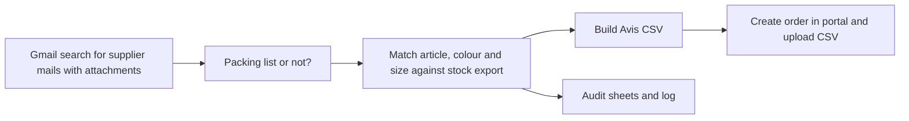

# Avis Apps Script

A Google Apps Script project that reads packing lists from supplier emails, matches them against the stock export and creates a purchase order in the internal purchasing portal. Built for the purchasing and warehouse team, so nobody has to retype a packing list by hand.

## Why

Suppliers announce a delivery (an "Avis") by sending a packing list as an Excel attachment. Before the goods arrive, someone had to open the file, find the right article, colour and size for every line, look up the EAN and enter all of it in the portal. Suppliers spell colours differently, mix up `2XL` and `XXL` or write `weib` instead of `weiß`, so this was slow and easy to get wrong. This script does the matching and the portal entry, and flags the lines it could not match instead of silently dropping them.

## How it works

1. `pruefeNeuePacklisten` is meant to run on a time trigger every 15 minutes. It searches Gmail for mails from the configured supplier senders that have attachments.
2. Each attachment is hashed. A file with the same content from the same supplier is never processed twice.
3. Attachments that are clearly packing lists are converted. Anything unclear is logged as "Manuell prüfen" and left alone.
4. `AvisCSV.js` reads the packing list, normalises article numbers, colours (a fixed alias list, no fuzzy guessing) and sizes, and looks up the variant and EAN in the stock export. Lines without a match are still kept, with a placeholder EAN and a short reason, so the order is complete and the gaps are visible.
5. `AvisPortalUpload.js` signs in with a dedicated automation account, creates an empty order, uploads the CSV and starts the import, the same four calls the portal makes when a person clicks through it. Open problems are written into the order reference.
6. Every run writes to audit sheets (run log, source rows, stock rows, automatic log) so a result can be checked later.
7. One mail attachment is handled per run. The rest follows on the next run. After three failed attempts a file is marked for manual review.

## Stack

* Google Apps Script (V8), Gmail, Sheets and Drive advanced service v3
* A Cognito login and the portal's HTTP endpoints through `UrlFetchApp`
* An older, secondary path that writes to a Neon test database over its HTTP SQL endpoint (`AvisDatenbank.js`)

## Setup

1. Create an Apps Script project and copy in the `.js` files and `appsscript.json`. The Drive advanced service is enabled in the manifest.
2. Set the script properties (Project settings, Script properties). Names only, values are not in the code:
   * `PORTAL_COGNITO_CLIENT_ID`, `PORTAL_AUTOMATION_USER`, `PORTAL_AUTOMATION_PASS`
   * `AVIS_INSTANCE_KEY`, `AVIS_STATUS`
   * `AVIS_SUPPLIER_LIEFERANT_I`, `AVIS_SUPPLIER_LIEFERANT_J` (supplier numbers in the portal)
   * `DB_HOST`, `DB_NAME`, `DB_USER`, `DB_PASS` (only for the test database path)
3. Run `avisSystemcheck()`. It lists which of the eleven properties are set, and never prints passwords.
4. Run `avisPortalAnmeldungTesten()` to check the portal login without creating anything.
5. Add the sender to supplier mapping and the sheet IDs for the stock export and the audit workbook in `AvisCSV.js`.
6. Create a time trigger for `pruefeNeuePacklisten` (every 15 minutes). The function only runs under the account it was written for.

`testLieferantAvisCsv`, `diagnoseZuordnung`, `artikelSuchen` and the `*Testen` functions in `AvisPortalUpload.js` are helpers for trying things out and finding out why a line did not match.

## Notes

* The portal cannot merge two orders (for example from two suppliers). `avisPortalZusammenfuehren_` is a workaround: it reads the lines of both, creates a new order and deletes the two old ones. A proper solution would have to be built into the portal itself.
* Unmatched lines still become order lines. I chose that on purpose, so a missing article never hides a whole delivery.
* The portal calls were found by watching the browser's network traffic, so they can break whenever the portal changes.

Built at Smilodox and published with permission. Supplier names, emails and business data were removed or replaced with placeholders.
